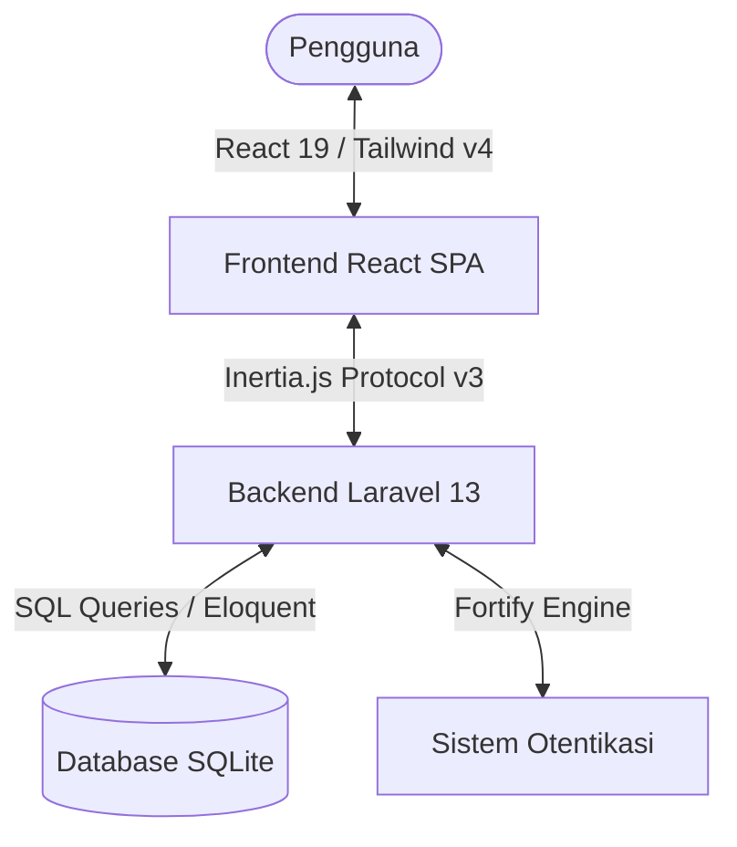

# Panduan Arsitektur Aplikasi Optira

Dokumen ini berisi analisis lengkap mengenai arsitektur sistem, komponen, routing, backend, dan frontend dari aplikasi **Optira** (Smart Assistive Technology for Inclusive Accessibility).

---

## 📌 1. Gambaran Umum Sistem (High-Level Architecture)

**Optira** dirancang sebagai aplikasi web berbasis **Single Page Application (SPA)** yang mengadopsi konsep *hybrid rendering*. 



Aplikasi ini menggunakan kombinasi teknologi modern:
*   **Backend:** Laravel 13 (berjalan pada PHP 8.5)
*   **Frontend:** React 19 & TypeScript dengan TailwindCSS v4
*   **Jembatan (Bridges):** Inertia.js v3 (menggantikan kebutuhan REST API tradisional untuk SPA)
*   **Database:** SQLite (Default)
*   **Pembungkus Tampilan (Viewport):** Mobile-first framed container (aplikasi web desktop yang dibungkus menyerupai tampilan smartphone/mobile).

---

## 🎨 2. Arsitektur Frontend (Client-Side)

Tampilan frontend terletak sepenuhnya di dalam direktori `resources/js/`. Aplikasi ini mengutamakan tampilan mobile yang terpusat dan memiliki animasi premium.

### A. Pola Layout Dinamis
Aplikasi menentukan layout secara dinamis di [app.tsx](file:///home/afrzl/Documents/lomba/Lomba%20ICT/source_code/Optira/resources/js/app.tsx) berdasarkan nama halaman:
*   **Halaman Utama & Auth Spesifik:** `welcome`, `privacy-policy`, `auth/login`, dan `auth/register` tidak menggunakan layout pembungkus (render langsung).
*   **Halaman Autentikasi Lainnya:** `auth/*` menggunakan [auth-layout.tsx](file:///home/afrzl/Documents/lomba/Lomba%20ICT/source_code/Optira/resources/js/layouts/auth-layout.tsx).
*   **Halaman Utama Aplikasi:** Halaman internal default dibungkus oleh [app-layout.tsx](file:///home/afrzl/Documents/lomba/Lomba%20ICT/source_code/Optira/resources/js/layouts/app-layout.tsx).
*   **Halaman Pengaturan & Tim:** Halaman di bawah `settings/` atau `teams/` menggunakan layout bersarang (*nested layout*): `AppLayout` -> `SettingsLayout`.

### B. Struktur & Hirarki Komponen Utama
Komponen UI dikelompokkan ke dalam dua kategori di `resources/js/components/`:

1.  **UI Primitives (Shadcn-like):**
    Terletak di `components/ui/` (seperti [button.tsx](file:///home/afrzl/Documents/lomba/Lomba%20ICT/source_code/Optira/resources/js/components/ui/button.tsx), [dialog.tsx](file:///home/afrzl/Documents/lomba/Lomba%20ICT/source_code/Optira/resources/js/components/ui/dialog.tsx), [sidebar.tsx](file:///home/afrzl/Documents/lomba/Lomba%20ICT/source_code/Optira/resources/js/components/ui/sidebar.tsx)).
2.  **Custom Brand Components:**
    *   [success-splash-screen.tsx](file:///home/afrzl/Documents/lomba/Lomba%20ICT/source_code/Optira/resources/js/components/success-splash-screen.tsx): Menampilkan animasi bola centang 3D *glossy* dengan efek *glassmorphism* dan gradien halus saat registrasi/login berhasil.
    *   [app-logo.tsx](file:///home/afrzl/Documents/lomba/Lomba%20ICT/source_code/Optira/resources/js/components/app-logo.tsx): Mengambil aset logo utama Optira `/images/logoOptira.png`.
    *   [team-switcher.tsx](file:///home/afrzl/Documents/lomba/Lomba%20ICT/source_code/Optira/resources/js/components/team-switcher.tsx): Dropdown untuk memindahkan konteks tim aktif bagi pengguna.
    *   **Modals Komponen Tim:** `create-team-modal`, `delete-team-modal`, `invite-member-modal`, `remove-member-modal`, dan `cancel-invitation-modal` untuk kolaborasi tim.

### C. Pembungkus Kanvas Mobile (Mobile Frame)
Melalui [app-layout.tsx](file:///home/afrzl/Documents/lomba/Lomba%20ICT/source_code/Optira/resources/js/layouts/app-layout.tsx), aplikasi merender kontainer berukuran `max-w-md` yang diposisikan di tengah layar desktop dengan latar belakang gelap. Di bagian bawah terdapat **Bottom Navigation Bar** berwarna merah muda/pink khas (`#E1005E`) yang berisi:
1.  **Dashboard:** Halaman utama setelah masuk (`/dashboard`).
2.  **Chat:** Akses chat pendamping/asisten (`/chat`, saat ini berupa tautan placeholder).
3.  **Call (Tombol Melayang Tengah):** Panggilan darurat/pendampingan langsung (`/call`).
4.  **Profile:** Halaman profil pengguna (`/profile`).
5.  **Settings:** Halaman konfigurasi akun (`/settings`).

### D. Halaman Call (`/call`)
Halaman call memiliki tampilan dan alur yang berbeda berdasarkan **peran pengguna**:

#### Alur Logika Peran dalam Panggilan
*   **Support Seeker (difabel)** adalah pihak yang **menelepon** (caller) — mereka menginisiasi panggilan ke Volunteer.
*   **Volunteer** adalah pihak yang **ditelpon** (receiver) — mereka menunggu dan menerima panggilan dari Support Seeker.

#### State Machine Halaman Call (4 State)
```
idle → calling → active → idle      (Difabel/Support Seeker: menginisiasi panggilan)
idle → ringing → active → idle      (Volunteer: menerima panggilan)
              ↘ idle                 (Volunteer: menolak panggilan)
```

#### Tampilan per Peran
| Peran | Idle State | Transisi |
|-------|-----------|----------|
| **Support Seeker (difabel)** | "A Call for Help" UI: kartu gradien ungu→pink fullscreen, ikon telepon besar, tap untuk menelepon | Tap card → `calling` → 4 detik auto-connect → `active` |
| **Volunteer** | Globe/Stats UI: gambar bumi, statistik (Support Seekers & Volunteers), nama user, tanggal bergabung, info notifikasi | Otomatis setelah 5 detik simulated → `ringing` → terima/tolak → `active` |

*   Layar `calling` (difabel): Animasi lingkaran berdering bergradien, teks "Berdering…", tombol hang up merah.
*   Layar `ringing` (volunteer): Animasi lingkaran + `PhoneIncoming` icon, tombol Terima (hijau) & Tolak (abu-abu).
*   Layar `active` (kedua peran): Video call UI penuh layar — thumbnail kamera diri (pojok kiri atas), badge timer (tengah atas), kontrol (rotate cam, toggle video, toggle mute, hang up merah).

#### Aset
*   Globe image: `public/images/globe.png` (digunakan di idle state volunteer).
*   Route: `GET /call` — meneruskan prop `role` dari `Auth::user()->role` ke halaman Inertia `call`.

---

## 🛠️ 3. Arsitektur Backend (Server-Side)

Backend Laravel 13 bertugas menangani logika bisnis, otentikasi aman, otorisasi peran, kolaborasi tim, dan manajemen basis data.

### A. Otentikasi & Fortify
Sistem otentikasi didukung penuh oleh **Laravel Fortify** yang dikustomisasi di [FortifyServiceProvider.php](file:///home/afrzl/Documents/lomba/Lomba%20ICT/source_code/Optira/app/Providers/FortifyServiceProvider.php):
*   **Registrasi & Reset Password:** Diarahkan pada kelas aksi khusus:
    *   [CreateNewUser.php](file:///home/afrzl/Documents/lomba/Lomba%20ICT/source_code/Optira/app/Actions/Fortify/CreateNewUser.php): Memvalidasi email, kata sandi, nomor telepon, dan tipe disabilitas jika pengguna mendaftar sebagai *Support Seeker*. Setelah pendaftaran berhasil, secara otomatis membuatkan satu Tim Personal baru.
    *   [ResetUserPassword.php](file:///home/afrzl/Documents/lomba/Lomba%20ICT/source_code/Optira/app/Actions/Fortify/ResetUserPassword.php): Menangani pembaruan kata sandi pengguna secara aman.
*   **Responses Kustom:** Fortify dikonfigurasi untuk mengembalikan respons JSON/Inertia kustom melalui kelas [LoginResponse.php](file:///home/afrzl/Documents/lomba/Lomba%20ICT/source_code/Optira/app/Http/Responses/LoginResponse.php), [RegisterResponse.php](file:///home/afrzl/Documents/lomba/Lomba%20ICT/source_code/Optira/app/Http/Responses/RegisterResponse.php), dan [VerifyEmailResponse.php](file:///home/afrzl/Documents/lomba/Lomba%20ICT/source_code/Optira/app/Http/Responses/VerifyEmailResponse.php).

### B. Peran Pengguna (User Roles)
Pengguna memiliki peran berbeda yang tersimpan pada kolom `role` di tabel `users`:
*   `difabel` (ditampilkan di frontend sebagai **Support Seeker**): Pengguna dengan kebutuhan aksesibilitas khusus. Memiliki data tambahan `support_type` (seperti *Bantuan Navigasi*, *Panggilan Telepon Pendamping*, dll.).
*   `volunteer` (ditampilkan di frontend sebagai **Volunteer**): Relawan yang mendaftar untuk mendampingi *Support Seekers*.
*   `admin`: Administrator aplikasi dengan hak akses penuh.

### C. Kolaborasi & Multi-Tenancy (Teams System)
Aplikasi memiliki fitur kolaborasi tim terintegrasi:
*   Setiap pengguna memiliki minimal satu tim personal.
*   Pengguna dapat diundang ke tim lain dengan peran khusus: **Owner**, **Admin**, atau **Member** yang diatur dalam Enum [TeamRole.php](file:///home/afrzl/Documents/lomba/Lomba%20ICT/source_code/Optira/app/Enums/TeamRole.php).
*   Pembagian hak akses di dalam tim diatur oleh Enum [TeamPermission.php](file:///home/afrzl/Documents/lomba/Lomba%20ICT/source_code/Optira/app/Enums/TeamPermission.php) (misal: `UpdateTeam`, `DeleteTeam`, `AddMember`, `CreateInvitation`).

---

## 🔀 4. Sistem Routing

Routing di aplikasi terbagi menjadi dua bagian utama: routing backend oleh Laravel dan routing frontend menggunakan **Laravel Wayfinder**.

### A. Route Backend (Laravel)
Didefinisikan di `routes/web.php` dan `routes/settings.php`:

```
GET/POST/PATCH/DELETE
   ├── /                                    --> welcome (Landing & Role selection)
   ├── /privacy-policy                      --> Kebijasi Privasi
   └── (Middleware: auth, verified)
         ├── /dashboard                     --> Dashboard Utama
         ├── /profile                       --> Profil Pengguna
         ├── /settings                      --> Redirects to /settings/profile
         │     ├── /settings/profile        --> Edit/Update/Delete Profile
         │     ├── /settings/security       --> Edit Password & 2FA (Requires Password Confirmation)
         │     ├── /settings/password       --> Update Password (Throttled)
         │     ├── /settings/appearance     --> Edit tema / tampilan halaman
         │     └── /settings/teams          --> Index, Store, Edit, Update, Delete & Switch Teams
         └── (Middleware: EnsureTeamMembership)
               ├── /settings/teams/{team}/members/{user}     --> Update/Remove members
               └── /settings/teams/{team}/invitations/{inv}  --> Invite/Cancel team invitations
```

### B. Route Frontend (Wayfinder Integration)
Aplikasi menggunakan **Laravel Wayfinder** (`@laravel/vite-plugin-wayfinder`). Wayfinder membaca route Laravel saat build time dan menghasilkan helper bertipe data TypeScript statis (terletak di `resources/js/routes/` dan `resources/js/actions/`).
*   **Penggunaan di Frontend:** Alih-alih menulis URL manual seperti `"/settings/profile"`, pengembang dapat memanggil fungsi TypeScript seperti `edit()` atau `login().url` untuk navigasi yang aman dari kesalahan penulisan (*type-safe*).

---

## 💾 5. Struktur Database & Model Relasional

Penyimpanan data default menggunakan **SQLite**. Hubungan relasi antar model didefinisikan sebagai berikut:

```
                  +-------------------+
                  |       users       |
                  +-------------------+
                  | id                |
                  | name, email, role |
                  | current_team_id   | <-------+
                  +-------------------+         |
                    |               |           |
                    | 1:N           | M:N       |
                    v               v           |
          +-----------------+   +------------+  |
          | team_invitations|   |    team    |  |
          +-----------------+   +------------+  |
          | id, email, role |   | id, name   | -+
          | team_id         |   | slug       |
          +-----------------+   +------------+
                                  |        |
                                  | 1:N    | 1:N
                                  v        v
                         +------------+  +-------------+
                         |team_members|  |  passkeys   |
                         +------------+  +-------------+
                         | user_id    |  | user_id     |
                         | team_id    |  | credential  |
                         | role       |  +-------------+
                         +------------+
```

### Penjelasan Relasi Eloquent
1.  **User <=> Team (Many-to-Many):** Diperoleh melalui pivot `team_members` yang menggunakan model [Membership.php](file:///home/afrzl/Documents/lomba/Lomba%20ICT/source_code/Optira/app/Models/Membership.php). Hubungan relasi diatur oleh trait `HasTeams` melalui `$user->teams()`.
2.  **User <=> Current Team (Belongs-to):** Menunjukkan konteks tim aktif pengguna melalui `$user->currentTeam()`.
3.  **Team <=> TeamInvitation (One-to-Many):** Daftar undangan anggota tim pending yang dikirimkan ke email tujuan.
4.  **User <=> Passkey (One-to-Many):** Mendukung login tanpa kata sandi (*passwordless*) menggunakan kredensial WebAuthn yang tersimpan di tabel `passkeys`.

---

## 🚀 6. Alur Kerja Utama (Core Workflows)

### A. Alur Registrasi Pengguna
1.  Pengguna mengunjungi halaman utama (`/`) dan disambungkan ke layar pemilihan peran (*Volunteer* atau *Support Seeker*).
2.  Memilih peran menambahkan parameter query `?role=volunteer` atau `?role=difabel` ke URL registrasi.
3.  Formulir pendaftaran (`register.tsx`) menyesuaikan input secara dinamis (input `support_type` hanya muncul untuk *Support Seeker*).
4.  Backend memvalidasi input via `CreateNewUser` dan membuat akun.
5.  Aksi backend membuatkan Tim Personal default untuk pengguna, mengaitkan status kepemilikan (`Owner`), dan memicu event untuk masuk pertama kali.
6.  Halaman dialihkan ke `/dashboard` yang memicu `SuccessSplashScreen` animasi centang 3D sebagai sambutan.

### B. Otorisasi Akses Tim
1.  Setiap permintaan ke rute `/settings/teams/{team}/*` dilewatkan ke middleware [EnsureTeamMembership.php](file:///home/afrzl/Documents/lomba/Lomba%20ICT/source_code/Optira/app/Http/Middleware/EnsureTeamMembership.php).
2.  Middleware memverifikasi apakah pengguna terautentikasi adalah anggota tim yang sah.
3.  Jika parameter `minimumRole` diberikan pada rute (misal: harus `Admin` atau `Owner`), middleware membandingkan tingkat hierarki peran pengguna menggunakan method `isAtLeast()` dari enum `TeamRole`.
4.  Jika valid, permintaan dilanjutkan. Jika tidak, mengembalikan pengecualian HTTP 403 (Unauthorized).

---

> [!NOTE]
> Arsitektur ini dibangun dengan memisahkan kekhawatiran (*separation of concerns*) yang jelas: Laravel menangani keamanan, data, dan kebijakan otorisasi, sementara React mengelola responsivitas UI dan interaksi modern pengguna.
